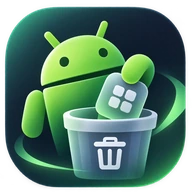

<p align="center">
  
</p>

<h1 align="center">Lethe</h1>

<p align="center">借助 Shizuku，免 Root 卸载 Android 预装应用与系统组件，并可随时恢复。</p>

---

Lethe 取名自希腊神话中的「遗忘之河」。它通过 [Shizuku](https://shizuku.rikka.app/) 以 shell（或 root）身份调用系统包管理服务，**仅针对用户 0（主用户）** 卸载应用。系统通常仍保留预装应用的安装包，因此被卸载的系统应用之后可以一键恢复。

## 功能

- **应用浏览**：列出用户 0 下的全部应用，按「全部 / 用户 / 系统 / 可恢复」筛选，支持按名称或包名搜索，可按名称、最近更新、安装包大小排序。浏览无需任何授权。
- **卸载（用户 0）**：等价于 `pm uninstall --user 0`，会删除该应用在用户 0 下的数据。卸载系统应用前需要额外勾选风险确认。
- **恢复**：等价于 `pm install-existing --user 0`，用系统保留的安装包为用户 0 重新安装（之前的数据不会恢复）。
- **结果核对**：每次卸载 / 恢复后都会重新查询包状态，确认操作真正生效后才报告成功。
- **执行日志**：记录每次读取、连接、卸载、恢复的过程与结果，可一键复制。
- **自我保护**：Lethe 自身和 Shizuku 不能通过本工具卸载；包名经过严格校验，任何非法输入都不会到达特权服务。

## 环境要求

- Android 9（API 28）及以上
- 已安装并启动 [Shizuku](https://shizuku.rikka.app/download/)（Shizuku API v13 及以上），可通过无线调试、电脑 ADB 或 Root 启动
- 需在主用户（用户 0）中运行

## 使用

1. 安装并启动 Shizuku。手机重启后通常需要重新启动 Shizuku。
2. 打开 Lethe，点击顶部状态卡上的「连接」，在 Shizuku 弹窗中允许授权。
3. 状态卡变为「已连接 · 可以卸载」后，点按任意应用查看详情，即可卸载或恢复。

> [!WARNING]
> 卸载系统组件可能导致部分功能异常甚至无法开机。请只卸载你清楚用途的应用；出现问题时可在「可恢复」中恢复。卸载会删除该应用的数据，且无法找回。

## 工作原理

```
Lethe（普通应用进程）
   │  AIDL: IUninstallService
   ▼
UninstallService（由 Shizuku 以 shell/root 身份启动的 UserService 进程）
   │  反射调用隐藏 API
   ▼
IPackageManager.deletePackageVersioned(user 0, DELETE_SYSTEM_APP)
IPackageManager.installExistingPackageAsUser(user 0)
```

- 特权服务只运行在 Shizuku 拉起的进程中，不作为导出的 Android 服务暴露；它会校验调用方 UID，仅接受 Lethe 自身、shell 和 root。
- 服务以非守护模式运行，Lethe 进程退出后由 Shizuku 自动回收。

## 构建

需要 JDK 17。

```bash
# Debug
./gradlew :app:assembleDebug

# 单元测试
./gradlew :app:testDebugUnitTest
```

Release 签名从 `keystore/keystore.properties` 读取（该目录已被 git 忽略，不会提交）：

```properties
storeFile=lethe-release.jks
storePassword=******
keyAlias=******
keyPassword=******
```

配置好后执行 `./gradlew :app:assembleRelease`。未提供该文件时，Release 包不签名。

## 技术栈

Kotlin · Jetpack Compose · Material 3 · Shizuku API · AIDL
